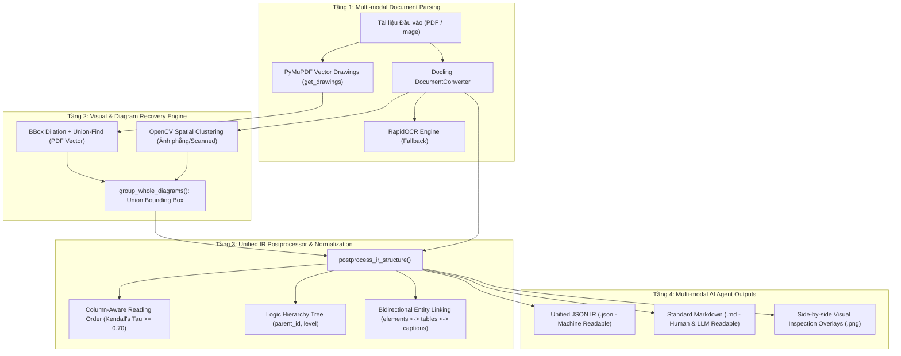

# DocuMind: Nền Tảng Hiểu & Tái Tạo Cấu Trúc Tài Liệu Đa Cột, Bảng Phức Tạp & Sơ Đồ Khối

[](https://www.python.org/)
[](https://github.com/astral-sh/uv)
[](https://github.com/DS4SD/docling)
[](https://github.com/opendatalab/OmniDocBench)

**DocuMind** là hệ thống xử lý, phân tích bố cục (Layout Analysis), nhận diện cấu trúc phân cấp (Hierarchy Tree) và phục hồi sơ đồ khối/bảng phức tạp cho các dạng tài liệu phi cấu trúc và bán cấu trúc (Báo cáo nghiên cứu 2 cột, bài báo khoa học, báo cáo tài chính có bảng merged cells, slide thuyết trình PPT2PDF và tài liệu kỹ thuật có biểu đồ phân mảnh).

Hệ thống được thiết kế theo lộ trình nghiên cứu và phát triển 8 tuần theo tài liệu [Topic3_Document_Understanding_8_Weeks.md](file:///C:/Workspace/DocuMind/Topic3_Document_Understanding_8_Weeks.md).

---

## 1. Kiến Trúc Hybrid 4 Tầng (Hybrid System Architecture)



### Các Thành Phần Nòng Cốt:
1. **Multi-modal Parsing Layer:** Kết hợp mô hình Layout Analysis và TableFormer của IBM Docling để trích xuất bounding box, bảng có cấu trúc và văn bản.
2. **Visual & Diagram Recovery Engine (`group_whole_diagrams`):** Giải quyết triệt để vấn đề sơ đồ bị cắt vụn thành hàng chục mảnh text/shape nhỏ lẻ. Tự động gom cụm hình khối, đường mũi tên và nhãn chữ thành **Union Bounding Box** duy nhất bao trọn toàn bộ sơ đồ/card.
3. **Unified IR Postprocessor (`postprocess_ir_structure`):** Chuẩn hóa toàn bộ dữ liệu theo đặc tả **Unified JSON IR Schema** (Mục 5.3):
   - Phân luồng thứ tự đọc nhận biết đa cột (Column-Aware Reading Order).
   - Dựng cây phân cấp logic (`title` -> `section_header` -> `text` / `table` / `diagram` -> `caption`).
   - Liên kết thực thể hai chiều giữa mảng `elements` và mảng `tables`.
4. **Dual Output Generation:** Xuất đồng thời cả file **JSON IR** (để AI Agent dễ truy vấn và gắn thêm metadata) lẫn file **Markdown** (nhúng bảng chi tiết kèm sơ đồ Mermaid).

---

## 2. Cấu Trúc Thư Mục Dự Án

```
DocuMind/
├── README.md                                  <- Tài liệu tổng quan dự án (file này)
├── Topic3_Document_Understanding_8_Weeks.md   <- Đề cương nghiên cứu & phát triển 8 tuần
├── .gitignore                                 <- Cấu hình loại trừ datasets, outputs, venv
├── docs/                                      <- Bộ tài liệu kỹ thuật chuyên sâu
│   ├── 01_architecture_and_ir_schema.md       <- Đặc tả Unified JSON IR Schema & Postprocessor
│   ├── 02_diagram_grouping_algorithm.md       <- Thuật toán group_whole_diagrams (Vector + Image)
│   └── 03_benchmark_and_stress_test.md        <- Báo cáo thực nghiệm 1.651 trang OmniDocBench
├── scripts/                                   <- Toàn bộ mã nguồn thực thi
│   ├── ir_postprocessor.py                    <- Module hậu xử lý IR, sắp xếp thứ tự đọc & cây phân cấp
│   ├── test_docling_omnidocbench.py           <- Pipeline benchmark Docling trên các mẫu đại diện
│   ├── test_diagram_grouping.py               <- Pipeline kiểm thử gom cụm sơ đồ khối
│   └── run_dataset_stress_test.py             <- Pipeline Stress Test quy mô lớn 2 tầng (1.651 trang)
├── datasets/                                  <- Dữ liệu OmniDocBench v1.6 (Ignored in Git)
│   └── OmniDocBench/
│       ├── OmniDocBench.json
│       └── images/
└── outputs/                                   <- Thư mục chứa kết quả kiểm thử (Ignored in Git)
    ├── README.md                              <- Mục lục tra cứu toàn bộ file sinh ra
    ├── 01_docling_benchmark/                  <- Mẫu benchmark Docling cơ sở
    ├── 02_diagram_grouping/                   <- Mẫu kiểm thử gom cụm sơ đồ
    └── 03_dataset_stress_test/                <- Kết quả stress test 1.651 trang & 6 issue overlays
```

---

## 3. Hướng Dẫn Cài Đặt (Installation)

Dự án sử dụng trình quản lý gói siêu tốc `uv`:

```powershell
# 1. Tạo môi trường ảo Python 3.11+
uv venv .venv

# 2. Kích hoạt môi trường ảo (Windows PowerShell)
.venv\Scripts\activate

# 3. Cài đặt các thư viện phụ thuộc
uv pip install docling pillow pymupdf opencv-python-headless
```

---

## 4. Hướng Dẫn Chạy Các Pipeline (Usage Guide)

### 4.1. Chạy Hậu Xử Lý Chuẩn Hóa IR (IR Postprocessor)
Kiểm thử bộ chuẩn hóa thứ tự đọc đa cột, cây phân cấp và liên kết bảng:
```powershell
.venv\Scripts\python scripts/ir_postprocessor.py
```

### 4.2. Chạy Benchmark Docling trên OmniDocBench
Thực hiện parse 4 mẫu văn bản đại diện (học thuật 2 cột, slide PPT, bảng merged 41x12, báo cáo tài chính):
```powershell
.venv\Scripts\python scripts/test_docling_omnidocbench.py
```
*Kết quả xuất tại:* `outputs/01_docling_benchmark/`

### 4.3. Chạy Thuật Toán Gom Cụm Sơ Đồ Khối (`group_whole_diagrams`)
Kiểm thử gom cụm sơ đồ trên slide cards, sơ đồ mạng, infographic và PDF vector lưu đồ hệ thống:
```powershell
.venv\Scripts\python scripts/test_diagram_grouping.py
```
*Kết quả xuất tại:* `outputs/02_diagram_grouping/`

### 4.4. Chạy Stress Test Quy Mô Lớn (1.651 Trang OmniDocBench)
Chạy kiểm thử 2 tầng trên CPU:
- **Tầng 1:** 1.651 trang toàn dataset đo Kendall's Tau trên 5 kiểu bố cục và 10 nguồn tài liệu.
- **Tầng 2:** 20 trang khó nhất chạy trọn vẹn End-to-End Docling + Diagram Grouping + IR Postprocessor và tự động phát hiện 6 lỗi dị thường kèm ảnh so sánh.
```powershell
.venv\Scripts\python scripts/run_dataset_stress_test.py
```
*Kết quả xuất tại:* `outputs/03_dataset_stress_test/`

---

## 5. Tài Liệu Kỹ Thuật Tham Khảo (Documentation)

- [Topic3_Document_Understanding_8_Weeks.md](file:///C:/Workspace/DocuMind/Topic3_Document_Understanding_8_Weeks.md): Bản đặc tả đề cương 8 tuần R&D.
- [docs/01_architecture_and_ir_schema.md](file:///C:/Workspace/DocuMind/docs/01_architecture_and_ir_schema.md): Đặc tả cấu trúc Unified JSON IR Schema & thuật toán hậu xử lý.
- [docs/02_diagram_grouping_algorithm.md](file:///C:/Workspace/DocuMind/docs/02_diagram_grouping_algorithm.md): Chi tiết toán học và thuật toán gom cụm sơ đồ khối.
- [docs/03_benchmark_and_stress_test.md](file:///C:/Workspace/DocuMind/docs/03_benchmark_and_stress_test.md): Báo cáo thực nghiệm toàn diện 1.651 trang và hướng khắc phục các edge cases.
