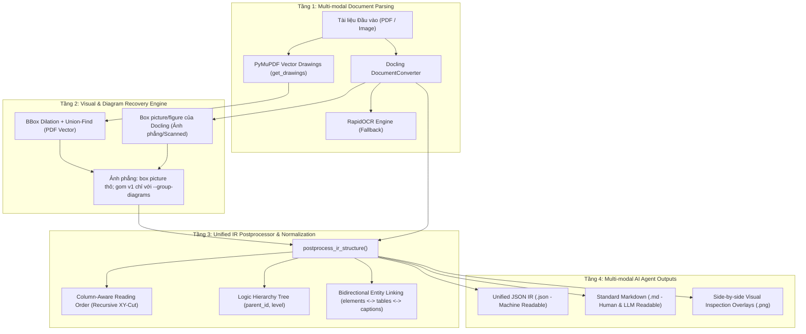

# DocuMind: Nền Tảng Hiểu & Tái Tạo Cấu Trúc Tài Liệu Đa Cột, Bảng Phức Tạp & Sơ Đồ Khối

[](https://www.python.org/)
[](https://github.com/astral-sh/uv)
[](https://github.com/DS4SD/docling)
[](https://github.com/opendatalab/OmniDocBench)

**DocuMind** là hệ thống xử lý, phân tích bố cục (Layout Analysis), nhận diện cấu trúc phân cấp (Hierarchy Tree) và phục hồi sơ đồ khối/bảng phức tạp cho các dạng tài liệu phi cấu trúc và bán cấu trúc (Báo cáo nghiên cứu 2 cột, bài báo khoa học, báo cáo tài chính có bảng merged cells, slide thuyết trình PPT2PDF và tài liệu kỹ thuật có biểu đồ phân mảnh).

Hệ thống được thiết kế theo lộ trình nghiên cứu và phát triển 8 tuần theo tài liệu [Topic3_Document_Understanding_8_Weeks.md](Topic3_Document_Understanding_8_Weeks.md).

> **Trạng thái hiện tại:** repo có (1) pipeline **ảnh phẳng → IR** (Docling + hậu xử lý IR), (2) pipeline **PDF → crop hình** (`scripts/run_pdf_figure_crops.py`: Docling trên trang render + gom v1 có luật neo + cụm vector bổ sung, đo trên 4 PDF AUTOSAR) và (3) bộ đánh giá. Pipeline PDF **chưa đi qua IR**: không có thứ tự đọc, cây phân cấp, bảng hay OCR, chỉ cắt hình. **Chưa có** DOCX/XLSX/PPTX, đối chiếu liên tài liệu, LLM, UI, TEDS và Graph F1. Không có entry point chung: mỗi script trong `scripts/` là một pipeline hoặc một bài đánh giá riêng. Trong pipeline IR, gom sơ đồ trên ảnh phẳng **tắt mặc định** (đo trên OmniDocBench cho thấy làm hại, xem `docs/02` mục 5.1); trong pipeline PDF, gom v1 **bật** kèm luật neo vì trên AUTOSAR nó giúp (`docs/02` mục 5.3-5.4). Nhánh vector thuần (PyMuPDF) đã đo trên AUTOSAR và kém, chỉ dùng làm tín hiệu bổ sung. Bàn giao chi tiết: [docs/04](docs/04_session_handoff_and_next_steps.md).

---

## 1. Kiến Trúc Hybrid 4 Tầng (Hybrid System Architecture)



### Các Thành Phần Nòng Cốt:
1. **Multi-modal Parsing Layer:** Kết hợp mô hình Layout Analysis và TableFormer của IBM Docling để trích xuất bounding box, bảng có cấu trúc và văn bản.
2. **Visual & Diagram Recovery (`group_whole_diagrams_*`, thử nghiệm):** nhánh vector gom nét vẽ và nhãn chữ của PDF số thành một **Union Bounding Box**; đo trên PDF AUTOSAR nó hút chữ kề sơ đồ và khoanh cả bảng (F1 chặt 0,416 so với 0,885 của Docling + v1), nên chỉ dùng bổ sung (`--add-vector-missing`). Với ảnh phẳng trong pipeline IR, mặc định giữ box `picture` thô của Docling và cắt ảnh từng box; gom cụm (v1) chỉ chạy khi truyền `--group-diagrams` vì đo trên 613 trang OmniDocBench cho thấy nó làm hỏng nhiều hình đang đúng hơn số hình nó sửa. Pipeline PDF → crop hình (mục 4.7) bật v1 kèm luật neo. Node/edge và Mermaid chưa được trích xuất tự động.
3. **Unified IR Postprocessor (`postprocess_ir_structure`):** Chuẩn hóa toàn bộ dữ liệu theo đặc tả **Unified JSON IR Schema** (Mục 5.3):
   - Phân luồng thứ tự đọc nhận biết đa cột (Recursive XY-Cut).
   - Dựng cây phân cấp logic (`title` -> `section_header` -> `text` / `table` / `diagram` -> `caption`; hai cấp tiêu đề).
   - Liên kết thực thể hai chiều giữa mảng `elements` và mảng `tables`.
4. **Dual Output Generation:** Xuất đồng thời cả file **JSON IR** (để AI Agent dễ truy vấn và gắn thêm metadata) lẫn file **Markdown** (nhúng bảng chi tiết kèm sơ đồ Mermaid).

---

## 2. Cấu Trúc Thư Mục Dự Án

```
DocuMind/
├── README.md                                  <- Tài liệu tổng quan dự án (file này)
├── Topic3_Document_Understanding_8_Weeks.md   <- Đề cương nghiên cứu & phát triển 8 tuần
├── .gitignore                                 <- Cấu hình loại trừ datasets, outputs, venv
├── docs/                                      <- Bộ tài liệu kỹ thuật chuyên sâu
│   ├── 01_architecture_and_ir_schema.md       <- Đặc tả Unified JSON IR Schema & Postprocessor
│   ├── 02_diagram_grouping_algorithm.md       <- Thuật toán gom sơ đồ (Vector + Image) và kết quả đo
│   ├── 03_benchmark_and_stress_test.md        <- Thực nghiệm OmniDocBench (Tầng 1 oracle, Tầng 2 end-to-end)
│   └── 04_session_handoff_and_next_steps.md   <- Bàn giao: số liệu đã kiểm chứng, lỗi đã biết, việc cần làm
├── scripts/                                   <- Toàn bộ mã nguồn thực thi
│   ├── ir_postprocessor.py                    <- Hậu xử lý IR: thứ tự đọc XY-Cut, cây phân cấp, liên kết bảng/caption, Markdown
│   ├── test_diagram_grouping.py               <- Gom sơ đồ (vector + ảnh phẳng v1), cắt crop, demo (đặt tên test_ nhưng là module dùng chung)
│   ├── diagram_grouping_v2.py                 <- Gom thận trọng v2 (chỉ dùng cho đánh giá)
│   ├── run_pdf_figure_crops.py                <- PDF -> crop từng hình (Docling OCR tắt + gom v1 có luật neo + cụm vector bổ sung), không qua IR
│   ├── run_figure_variants_all.py             <- Chạy 9 biến thể cắt hình trên nhiều PDF để so sánh bằng mắt
│   ├── eval_pdf_figure_variants.py            <- Chấm điểm các biến thể với ground truth AUTOSAR (chặt IoU và dung sai)
│   ├── ground_truth/autosar_layered_figures.json <- 30 box hình gán tay trên 44 trang LayeredSoftwareArchitecture
│   ├── run_dataset_stress_test.py             <- Stress test 2 tầng (Tầng 1 trên box GT, Tầng 2 end-to-end 20 trang)
│   ├── test_docling_omnidocbench.py           <- Benchmark Docling trên 4 mẫu đại diện
│   ├── eval_utils.py                          <- Hàm đánh giá dùng chung (Kendall tau, Hungarian, IoU, phân loại hình)
│   ├── run_e2e_reading_order_eval.py          <- Đánh giá thứ tự đọc end-to-end (4 phương pháp A/B/C/D)
│   ├── check_furniture_layer.py               <- Kiểm tra lớp FURNITURE (header/footer) của Docling
│   ├── run_diagram_crop_eval.py (+ _v2, _v3, _v4) <- Đánh giá cắt hình trên 613 trang (v3 leave-source-out, v4 veto)
│   ├── analyze_pair_features.py               <- Phân tích đặc trưng cặp mảnh hình
│   ├── test_eval_utils.py                     <- 35 test cho eval_utils và v2 (assert thuần)
│   └── test_ir_postprocessor.py               <- 6 test cho hậu xử lý IR (assert thuần)
├── datasets/                                  <- Dữ liệu (Ignored in Git)
│   ├── OmniDocBench/                          <- OmniDocBench v1.6 (OmniDocBench.json, images/)
│   └── AUTOSAR/                               <- 4 PDF AUTOSAR CP R24-11 tải từ autosar.org (điều khoản sử dụng riêng)
└── outputs/                                   <- Thư mục chứa kết quả (Ignored in Git)
    ├── README.md                              <- Mục lục tra cứu file sinh ra (cục bộ, có thể lỗi thời)
    ├── 01_docling_benchmark/                  <- Mẫu benchmark Docling cơ sở
    ├── 02_diagram_grouping/                   <- Kết quả demo gom sơ đồ
    ├── 03_dataset_stress_test/                <- Kết quả stress test & issue overlays
    ├── 04_e2e_eval/                           <- Đánh giá thứ tự đọc end-to-end (+ cache Docling theo cấu hình)
    ├── 05_diagram_crop_eval/                  <- Đánh giá cắt hình (report_v2/v3/v4, results_*.json)
    ├── 08_pdf_figure_crops/                   <- Crop hình từ PDF + cache Docling theo trang (run_pdf_figure_crops.py)
    └── 10_.../12_autosar_all_variants_*/      <- So sánh 9 biến thể trên 4 PDF (run_figure_variants_all.py)
```

---

## 3. Hướng Dẫn Cài Đặt (Installation)

Dự án sử dụng trình quản lý gói `uv`. Môi trường đã được kiểm thử: Python 3.12.10 trên Windows 11, Docling 2.150.0, PyMuPDF 2.1, OpenCV (`opencv-python-headless`) 5.0.0.93, SciPy 1.18, NumPy 2.5, Pillow 13, RapidOCR 3.10, onnxruntime 1.31 (CPU).

```powershell
# 1. Tạo môi trường ảo Python 3.11+ (đã kiểm thử với 3.12)
uv venv .venv

# 2. Kích hoạt môi trường ảo (Windows PowerShell)
.venv\Scripts\activate

# 3. Cài đặt các thư viện phụ thuộc
uv pip install docling pillow pymupdf opencv-python-headless scipy

# 4. (Tùy chọn) torch bản CUDA để chạy Docling/RapidOCR trên GPU. Ví dụ đã dùng (GTX 1650, CUDA 12.6):
uv pip install --python .venv/Scripts/python.exe "torch==2.14.1+cu126" "torchvision==0.29.1+cu126" --index-url https://download.pytorch.org/whl/cu126
```

Lưu ý: repo chưa có `pyproject.toml`/`requirements.txt`/lock file, nên các phiên bản trên chỉ là cấu hình đã chạy được, không được ghim. `pytest` không được cài sẵn; các file `test_eval_utils.py` và `test_ir_postprocessor.py` chạy trực tiếp bằng `python`. Trên Windows, đọc ảnh bằng OpenCV phải qua `read_image_bgr` (`cv2.imread` thất bại im lặng với đường dẫn không-ASCII).

---

## 4. Hướng Dẫn Chạy Các Pipeline (Usage Guide)

### 4.1. Chạy Hậu Xử Lý Chuẩn Hóa IR (IR Postprocessor)
Kiểm thử bộ chuẩn hóa thứ tự đọc đa cột, cây phân cấp và liên kết bảng:
```powershell
.venv\Scripts\python scripts/ir_postprocessor.py
```
> **Cảnh báo:** chạy trực tiếp file này sẽ **ghi đè** các file JSON/Markdown trong `outputs/` (đường dẫn gốc `C:/Workspace/DocuMind` được ghi cứng trong `main()`).

### 4.2. Chạy Benchmark Docling trên OmniDocBench
Thực hiện parse 4 mẫu văn bản đại diện (học thuật 2 cột, slide PPT, bảng merged 41x12, báo cáo tài chính):
```powershell
.venv\Scripts\python scripts/test_docling_omnidocbench.py
```
*Kết quả xuất tại:* `outputs/01_docling_benchmark/`

### 4.3. Chạy Demo Gom Sơ Đồ Khối (`group_whole_diagrams`)
Demo trên slide cards, sơ đồ mạng, infographic và PDF vector lưu đồ tổng hợp. Mặc định giữ box `picture` thô của Docling; thêm `--group-diagrams` để chạy gom v1:
```powershell
.venv\Scripts\python scripts/test_diagram_grouping.py
.venv\Scripts\python scripts/test_diagram_grouping.py --group-diagrams
```
*Kết quả xuất tại:* `outputs/02_diagram_grouping/` (**ghi đè** các file cũ trong thư mục này).

### 4.4. Chạy Stress Test 2 Tầng (OmniDocBench)
- **Tầng 1:** đo Kendall's Tau trên **1.602 trang hợp lệ** (trên 1.651 trang; 49 trang có dưới 2 phần tử GT bị loại), đầu vào là **bbox ground truth**, nên kết quả (0,9369) là **trần oracle** của thuật toán sắp xếp, không phải điểm end-to-end.
- **Tầng 2:** 20 trang khó nhất chạy trọn vẹn Docling -> box picture thô (hoặc gom v1 với `--group-diagrams`) -> cắt ảnh từng diagram vào `crops/` -> IR Postprocessor; tự động phát hiện 6 lỗi dị thường kèm ảnh so sánh.
```powershell
.venv\Scripts\python scripts/run_dataset_stress_test.py
.venv\Scripts\python scripts/run_dataset_stress_test.py --group-diagrams
```
*Kết quả xuất tại:* `outputs/03_dataset_stress_test/` (**ghi đè** các file cũ trong thư mục này).

### 4.5. Kiểm Thử Đơn Vị
```powershell
.venv\Scripts\python scripts/test_eval_utils.py        # 35 test
.venv\Scripts\python scripts/test_ir_postprocessor.py   # 6 test
```

### 4.6. Đánh Giá Định Lượng
```powershell
# Thứ tự đọc end-to-end, 300 trang phân tầng, torch trên GPU (~20-23 phút, có cache)
.venv\Scripts\python scripts/run_e2e_reading_order_eval.py --stratified 300 --seed 42 --ocr-backend torch --device cuda
# Cắt hình trên 613 trang (dùng cache OCR tắt)
.venv\Scripts\python scripts/run_diagram_crop_eval_v3.py
.venv\Scripts\python scripts/run_diagram_crop_eval_v4.py
```
*Kết quả xuất tại:* `outputs/04_e2e_eval/` và `outputs/05_diagram_crop_eval/`. Chi tiết và số liệu đã kiểm chứng: `docs/04`.

---

### 4.7. PDF → Crop Hình (không qua IR)
Mỗi hình trong PDF (ảnh hoặc sơ đồ nhiều mảnh) ra một ảnh crop; nội dung trong hình xử lý sau. Docling chạy với OCR tắt trên trang render, nên nhanh (khoảng 0,3 giây/trang trên GPU, lần đầu có thêm thời gian tải model):
```powershell
.venv\Scripts\python scripts/run_pdf_figure_crops.py datasets/AUTOSAR/AUTOSAR_CP_EXP_LayeredSoftwareArchitecture.pdf
# cấu hình khuyến nghị theo đo hiện tại (Docling + v1 có luật neo + thêm cụm vector bị sót):
.venv\Scripts\python scripts/run_pdf_figure_crops.py file.pdf --add-vector-missing --pages 12-40
# bỏ gom v1 hoặc đổi luật neo: --no-group, --v1-rule {anchor,picture-only,none}
```
*Kết quả xuất tại:* `outputs/08_pdf_figure_crops/<tên pdf>/` (`crops/`, `manifest.json`). Cache Docling theo trang nằm ở `_docling_cache_dpi150/` cùng thư mục gốc, nên chạy lại biến thể khác không phải chạy lại Docling.

So sánh nhiều biến thể trên nhiều PDF (ảnh ghép 4 biến thể cho các trang bất đồng) và chấm điểm với ground truth:
```powershell
.venv\Scripts\python scripts/run_figure_variants_all.py datasets/AUTOSAR/*.pdf
.venv\Scripts\python scripts/eval_pdf_figure_variants.py datasets/AUTOSAR/AUTOSAR_CP_EXP_LayeredSoftwareArchitecture.pdf
```
*Kết quả xuất tại:* `outputs/10_autosar_all_variants/`. Ground truth chỉ có cho `LayeredSoftwareArchitecture` (30 box gán tay); số liệu và giới hạn ở `docs/02` mục 5.3-5.4.

---

## 5. Tài Liệu Kỹ Thuật Tham Khảo (Documentation)

- [Topic3_Document_Understanding_8_Weeks.md](Topic3_Document_Understanding_8_Weeks.md): Bản đặc tả đề cương 8 tuần R&D.
- [docs/01_architecture_and_ir_schema.md](docs/01_architecture_and_ir_schema.md): Cấu trúc Unified JSON IR thực tế & thuật toán hậu xử lý.
- [docs/02_diagram_grouping_algorithm.md](docs/02_diagram_grouping_algorithm.md): Thuật toán gom sơ đồ khối, kết quả đo trên OmniDocBench và PDF AUTOSAR, và pipeline PDF → crop hình.
- [docs/03_benchmark_and_stress_test.md](docs/03_benchmark_and_stress_test.md): Thực nghiệm OmniDocBench (Tầng 1 oracle, Tầng 2 end-to-end) và các edge case.
- [docs/04_session_handoff_and_next_steps.md](docs/04_session_handoff_and_next_steps.md): Bàn giao session: số liệu đã kiểm chứng, lỗi đã biết, việc cần làm tiếp.
