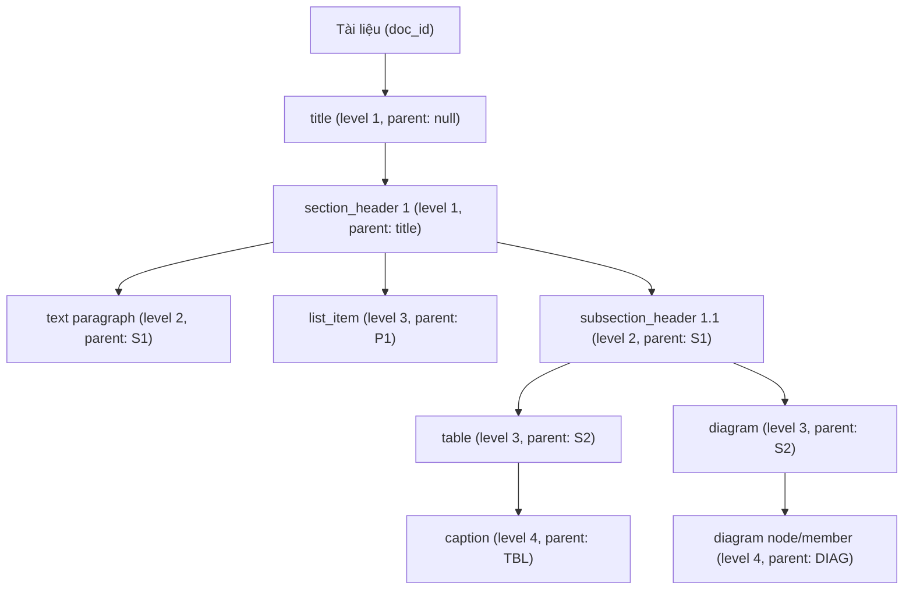

# ĐẶC TẢ KIẾN TRÚC & UNIFIED JSON IR SCHEMA

Tài liệu này đặc tả chi tiết mô hình dữ liệu trung gian chuẩn hóa (**Unified JSON Intermediate Representation - IR**) theo **Mục 5.3 của `Topic3_Document_Understanding_8_Weeks.md`**, cùng các thuật toán hậu xử lý cấu trúc tài liệu (`scripts/ir_postprocessor.py`) trong hệ thống **DocuMind**.

---

## 1. Mục Tiêu Thiết Kế Của Unified JSON IR

Các thư viện bóc tách tài liệu hiện nay (như Docling, PyMuPDF, Unstructured) thường xuất dữ liệu ở dạng phẳng (flat list) hoặc định dạng Markdown thuần túy. Điều này tạo ra ba rào cản lớn đối với hệ thống AI Agent:
1. **Thiếu ngữ cảnh phân cấp (Flat Hierarchy):** Các đoạn văn bản, bảng biểu, ảnh minh họa không biết mình thuộc về chương/mục nào.
2. **Sai lệch thứ tự đọc trong bố cục đa cột (Reading Order Jumps):** Các thuật toán quét tọa độ từ trên xuống dưới theo trang giấy ($y$-axis sort) thường làm đảo lộn nội dung giữa cột trái và cột phải (ví dụ: một bảng ở đầu cột phải bị đọc xen vào giữa đoạn văn của cột trái).
3. **Mất liên kết thực thể (Entity Disconnect):** Khối bảng (Table) trong danh sách phần tử chỉ chứa text sơ sài, trong khi cấu trúc tế bào chi tiết (cells, merged headers) lại nằm tách biệt trong đối tượng khác mà không có khóa ngoại (foreign key) liên kết.

**Unified JSON IR** được thiết kế để giải quyết toàn diện ba thách thức trên, cung cấp định dạng chuẩn hóa, dễ dàng mở rộng và bổ sung metadata từ các mô hình AI/LLM.

---

## 2. Đặc Tả Chi Tiết Schema (Unified JSON IR Specification)

Mỗi tài liệu sau khi qua pipeline của DocuMind sẽ được xuất thành một file `.json` tuân thủ nghiêm ngặt cấu trúc dưới đây:

```json
{
  "$schema": "https://documind.ai/schemas/unified_ir_v1.json",
  "doc_id": "01_academic_2col",
  "source_file": "page-83587fc3-fe55-4e51-a3c5-f0664edba743.png",
  "doc_type": "academic_literature",
  "metadata": {
    "category": "academic_literature",
    "description": "Hai cot, co bang bieu va chu thich",
    "page_width": 1700.0,
    "page_height": 2200.0,
    "parser": "docling-2.15 + ir_postprocessor",
    "reading_order_status": "column_aware_sorted",
    "total_elements": 16,
    "total_tables": 2,
    "total_diagrams": 0
  },
  "elements": [
    {
      "id": "elem_0001",
      "type": "section_header",
      "level": 1,
      "parent_id": null,
      "reading_order": 1,
      "bbox": [152.0, 185.0, 780.0, 220.0],
      "text": "3. EXPERIMENTAL SETUP",
      "metadata": {
        "column": "left_col"
      }
    },
    {
      "id": "elem_0009",
      "type": "table",
      "level": 2,
      "parent_id": "elem_0001",
      "reading_order": 9,
      "bbox": [880.0, 180.0, 1550.0, 480.0],
      "text": "[Table tbl_0002: Table 2: Performance metrics on benchmark dataset]",
      "table_id": "tbl_0002",
      "metadata": {
        "column": "right_col"
      }
    },
    {
      "id": "elem_0010",
      "type": "caption",
      "level": 3,
      "parent_id": "elem_0009",
      "reading_order": 10,
      "bbox": [880.0, 490.0, 1550.0, 520.0],
      "text": "Table 2: Performance metrics on benchmark dataset",
      "metadata": {
        "column": "right_col",
        "target_id": "elem_0009"
      }
    }
  ],
  "tables": [
    {
      "table_id": "tbl_0002",
      "element_id": "elem_0009",
      "caption_id": "elem_0010",
      "caption_text": "Table 2: Performance metrics on benchmark dataset",
      "bbox": [880.0, 180.0, 1550.0, 480.0],
      "num_rows": 5,
      "num_cols": 4,
      "markdown": "| Metric | Baseline | Ours | Gain |\n|---|---|---|---|\n| Accuracy | 78.4% | 86.2% | +7.8% |",
      "cells": [
        {
          "row_idx": 0,
          "col_idx": 0,
          "rowspan": 1,
          "colspan": 1,
          "is_merged": false,
          "is_header": true,
          "text": "Metric"
        }
      ],
      "metadata": {
        "column": "right_col",
        "has_merged_cells": false
      }
    }
  ],
  "diagrams": []
}
```

---

## 3. Ba Thuật Toán Hậu Xử Lý Cốt Lõi (`ir_postprocessor.py`)

### 3.1. Thuật Toán Sắp Xếp Thứ Tự Đọc Nhận Biết Đa Cột (Column-Aware Reading Order)

#### Bài toán:
Trong tài liệu 2 cột (như bài báo khoa học IEEE/ACM), các thuật toán chuẩn thường sắp xếp block theo tọa độ dọc $y_{\min}$. Nếu ở đầu cột 2 (bên phải) có một Bảng biểu hoặc Tiêu đề mục nằm ở tọa độ $y = 180$, nó sẽ bị xếp chen vào giữa các đoạn văn của cột 1 (bên trái) nằm ở tọa độ $y \approx 200 - 600$.

#### Giải pháp trong `postprocess_ir_structure()`:
1. **Phát hiện Bố cục 2 cột (2-Column Detection):**
   Xác định trục trung tâm của trang: $\text{mid\_x} = \frac{\text{page\_width}}{2}$.
   Phân loại từng phần tử $e$ có bounding box $[x_{\min}, y_{\min}, x_{\max}, y_{\max}]$:
   - `full_width`: nếu $x_{\min} < 0.42 \cdot W$ và $x_{\max} > 0.58 \cdot W$ (các block trải rộng cả 2 cột như Title, Abstract, Full-width Table).
   - `left_col`: nếu $x_{\max} \le 0.54 \cdot W$ hoặc $\frac{x_{\min} + x_{\max}}{2} < 0.48 \cdot W$.
   - `right_col`: nếu $x_{\min} \ge 0.46 \cdot W$ hoặc $\frac{x_{\min} + x_{\max}}{2} > 0.52 \cdot W$.
2. **Kiểm tra Điều kiện Trang Đa Cột:**
   Trang được coi là đa cột khi đồng thời thỏa mãn:
   $$\text{len}(\text{left\_col}) \ge 2 \quad \text{và} \quad \text{len}(\text{right\_col}) \ge 2$$
3. **Sắp xếp Độc Lập Theo Phân Vùng:**
   - Các block `full_width` ở nửa trên trang ($y_{\max} \le \min(y_{\min}(\text{left}), y_{\min}(\text{right}))$) được đọc đầu tiên, sắp xếp tăng dần theo $y_{\min}$.
   - Đọc **toàn bộ cột trái** (`left_col`) từ trên xuống dưới tăng dần theo $y_{\min}$.
   - Đọc tiếp **toàn bộ cột phải** (`right_col`) từ trên xuống dưới tăng dần theo $y_{\min}$.
   - Cuối cùng đọc các block `full_width` ở chân trang (Footer, References tràn trang).
4. **Kết quả xác thực trên mẫu `01_academic_2col`:**
   - **Trước khi sửa:** `Table 2` bị gán `reading_order: 2` (chen ngang giữa cột trái), trong khi `Caption Table 2` nằm ở `reading_order: 10`.
   - **Sau khi sửa:** `Table 2` được di chuyển chuẩn xác về `reading_order: 9`, nằm ngay trước `Caption Table 2` (`reading_order: 10`), khôi phục tính toàn vẹn 100% của luồng đọc khoa học.

---

### 3.2. Thuật Toán Xây Dựng Cây Phân Cấp Logic (Hierarchy Tree Construction)

Thuật toán tự động tái lập mối quan hệ cha-con (`parent_id`) và cấp bậc ngữ nghĩa (`level`) dựa trên luồng đọc đã được chuẩn hóa:



#### Quy tắc gán `level` và `parent_id`:
1. `title`: Gán `level = 1`, `parent_id = null`. Cập nhật `current_title_id = elem.id`.
2. `section_header`:
   - Nếu là tiêu đề chính: `level = 1`, `parent_id = current_title_id`.
   - Nếu là tiêu đề phụ (bắt đầu bằng `1.1`, `A.`,...): `level = 2`, `parent_id = current_section_id`.
   - Cập nhật `current_section_id = elem.id`, `current_section_level = level`.
3. `text`, `table`, `picture`, `formula`:
   - `level = current_section_level + 1`.
   - `parent_id = current_section_id` (nếu có) hoặc `current_title_id` hoặc `null`.
4. `list_item`:
   - Gán phụ thuộc vào block văn bản dẫn nhập phía trước: `level = last_text_level + 1`, `parent_id = last_text_id`.
5. `caption`:
   - Tự động dò tìm khối Bảng (`table`) hoặc Hình vẽ (`picture`) liền kề phía trước hoặc phía sau trong khoảng cách $\Delta y \le 80\text{px}$.
   - Gán: `parent_id = target_element.id`, `level = target_element.level + 1`.
6. Phần tử con trong sơ đồ khối (`diagram_member`):
   - Gán: `parent_id = diagram_group.id`, `level = 3`.

---

### 3.3. Thuật Toán Liên Kết Thực Thể Hai Chiều (Bidirectional Entity Linking)

Để bảo đảm tính đồng nhất dữ liệu giữa biểu diễn trực quan và dữ liệu ngữ nghĩa:
1. **Chiều Xuôi (`elements -> tables`):**
   - Với mỗi phần tử `type: "table"` trong danh sách `elements`, tìm kiếm bảng tương ứng trong mảng `tables` dựa trên chỉ số hoặc tọa độ BBox giao nhau (IoU $\ge 0.8$).
   - Gán trường `table_id = "tbl_XXXX"` vào đối tượng `element`.
   - Cập nhật trường `text` của element bằng chuỗi tóm tắt ngữ nghĩa:
     `"[Table tbl_XXXX: <Tên Caption Nếu Có>]"` thay vì để trống `""`.
2. **Chiều Ngược (`tables -> elements & captions`):**
   - Trong mỗi bảng ở mảng `tables`, bổ sung các trường khóa ngoại:
     - `element_id`: Trỏ ngược lại `id` của khối layout trong `elements`.
     - `caption_id`: Trỏ tới `id` của nhãn chú thích tương ứng.
     - `caption_text`: Lưu nội dung chú thích phục vụ trích xuất nhanh mà không cần join bảng.
3. **Chuẩn Hóa Tế Bào (Cell-Level Normalization):**
   - Trích xuất chi tiết từng tế bào: `row_idx`, `col_idx`, `rowspan`, `colspan`, `is_merged`, `text`, `is_header`.
   - Tự động phát hiện cờ `has_merged_cells: true` khi có bất kỳ ô nào có `rowspan > 1` hoặc `colspan > 1`.
   - Sinh bảng Markdown chuẩn (`markdown`) phản ánh đúng ma trận tế bào đã gộp.

---

## 4. Cơ Chế Sinh File Kép (JSON IR + GitHub-Flavored Markdown)

Hàm `generate_markdown_from_ir(processed_ir)` duyệt tuần tự theo mảng `elements` đã sắp xếp theo `reading_order` chuẩn:
- `title` -> Chuyển thành `# <text>`
- `section_header` -> Chuyển thành `## <text>` hoặc `### <text>` tùy theo `level`.
- `text` -> Chuyển thành đoạn văn `<text>\n\n`.
- `list_item` -> Chuyển thành `- <text>`.
- `table` -> Nhúng trực tiếp chuỗi `markdown` từ mảng `tables` qua khóa ngoại `table_id`.
- `diagram` -> Nhúng ảnh crop tương ứng hoặc mã nguồn **Mermaid Flowchart** nếu có dữ liệu quan hệ các nút (`nodes`, `edges`).

Nhờ đó, dữ liệu đầu ra phục vụ song song cả hai nhu cầu: **AI Agent đọc JSON có cấu trúc để reasoning** và **Con người / LLM đọc Markdown để duyệt nội dung tự nhiên**.
