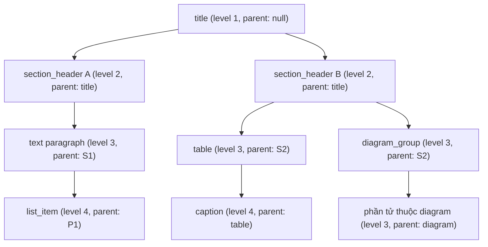

# ĐẶC TẢ KIẾN TRÚC & UNIFIED JSON IR SCHEMA

Tài liệu này đặc tả chi tiết mô hình dữ liệu trung gian chuẩn hóa (**Unified JSON Intermediate Representation - IR**) theo **Mục 5.3 của `Topic3_Document_Understanding_8_Weeks.md`**, cùng các thuật toán hậu xử lý cấu trúc tài liệu (`scripts/ir_postprocessor.py`) trong hệ thống **DocuMind**.

---

## 1. Mục Tiêu Thiết Kế Của Unified JSON IR

Các thư viện bóc tách tài liệu hiện nay (như Docling, PyMuPDF, Unstructured) thường xuất dữ liệu ở dạng phẳng (flat list) hoặc định dạng Markdown thuần túy. Điều này tạo ra ba rào cản lớn đối với hệ thống AI Agent:
1. **Thiếu ngữ cảnh phân cấp (Flat Hierarchy):** Các đoạn văn bản, bảng biểu, ảnh minh họa không biết mình thuộc về chương/mục nào.
2. **Sai lệch thứ tự đọc trong bố cục đa cột (Reading Order Jumps):** Các thuật toán quét tọa độ từ trên xuống dưới theo trang giấy ($y$-axis sort) thường làm đảo lộn nội dung giữa cột trái và cột phải (ví dụ: một bảng ở đầu cột phải bị đọc xen vào giữa đoạn văn của cột trái).
3. **Mất liên kết thực thể (Entity Disconnect):** Khối bảng (Table) trong danh sách phần tử chỉ chứa text sơ sài, trong khi cấu trúc tế bào chi tiết (cells, merged headers) lại nằm tách biệt trong đối tượng khác mà không có khóa ngoại (foreign key) liên kết.

**Unified JSON IR** được thiết kế để giải quyết toàn diện ba thách thức trên, cung cấp định dạng chuẩn hóa, dễ dàng mở rộng và bổ sung metadata từ các mô hình AI/LLM.

---

## 2. Đặc Tả Chi Tiết Schema (Unified JSON IR Specification)

Mỗi tài liệu sau khi qua pipeline của DocuMind (`scripts/run_dataset_stress_test.py`, Tầng 2) được xuất thành một file `.json` có cấu trúc dưới đây. Ví dụ phản ánh **các trường mã nguồn thực sự sinh ra** (xem cuối mục này về các trường đặc tả đích chưa có); các giá trị cụ thể là minh họa. Tọa độ `bbox` đều là **pixel của ảnh trang**; `reading_order` đếm từ **0**; `id` được đánh lại `elem_NNNN` theo đúng thứ tự đọc.

```json
{
  "doc_id": "sample_03_academic_1andmo",
  "source_file": "page-83587fc3-fe55-4e51-a3c5-f0664edba743.png",
  "doc_type": "raster_image",
  "metadata": {
    "category": "academic_literature",
    "description": "Layout: 1andmore_column, Issues: ['table_wireless_line']",
    "page_width": 1700,
    "page_height": 2200,
    "parser": "Docling-2.150.0 + raw picture boxes",
    "processing_time_sec": 14.2,
    "custom_tags": ["academic_literature", "1andmore_column", "table_wireless_line"],
    "extra": {"total_docling_blocks": 13, "total_tables": 2, "total_diagram_groups": 2, "gt_dets_count": 15}
  },
  "elements": [
    {
      "id": "elem_0001",
      "type": "section_header",
      "page": 1,
      "bbox": [152.0, 185.0, 780.0, 220.0],
      "reading_order": 0,
      "level": 1,
      "parent_id": null,
      "text": "3. EXPERIMENTAL SETUP",
      "source_ref": {"file": "page-83587fc3-fe55-4e51-a3c5-f0664edba743.png", "page": 1, "bbox": [152.0, 185.0, 780.0, 220.0]},
      "confidence": 0.95,
      "metadata": {"raw_order": 0}
    },
    {
      "id": "elem_0009",
      "type": "table",
      "page": 1,
      "bbox": [880.0, 180.0, 1550.0, 480.0],
      "reading_order": 8,
      "level": 2,
      "parent_id": "elem_0001",
      "text": "[Table tbl_0002: Table 2: Performance metrics on benchmark dataset]",
      "table_id": "tbl_0002",
      "metadata": {"raw_order": 8, "table_id": "tbl_0002"}
    },
    {
      "id": "elem_0010",
      "type": "caption",
      "page": 1,
      "bbox": [880.0, 490.0, 1550.0, 520.0],
      "reading_order": 9,
      "level": 3,
      "parent_id": "elem_0009",
      "text": "Table 2: Performance metrics on benchmark dataset",
      "metadata": {"raw_order": 9}
    }
  ],
  "tables": [
    {
      "id": "tbl_0002",
      "page": 1,
      "bbox": [880.0, 180.0, 1550.0, 480.0],
      "num_rows": 5,
      "num_cols": 4,
      "cells": [
        {"row": 0, "col": 0, "rowspan": 1, "colspan": 1, "text": "Metric", "is_header": true, "is_merged": false, "bbox": [880.0, 180.0, 1000.0, 210.0]}
      ],
      "html": "<table>...</table>",
      "source_ref": {"file": "page-83587fc3-fe55-4e51-a3c5-f0664edba743.png", "page": 1, "bbox": [880.0, 180.0, 1550.0, 480.0]},
      "metadata": {
        "element_id": "elem_0009",
        "caption_id": "elem_0010",
        "caption_text": "Table 2: Performance metrics on benchmark dataset"
      }
    }
  ],
  "diagrams": [
    {
      "id": "diag_0001",
      "page": 1,
      "bbox": [144.2, 1529.7, 511.9, 2041.8],
      "cropped_image": "crops/sample_03_academic_1andmo_diag_0001.png",
      "merged_element_ids": ["elem_0007"],
      "text_summary": "",
      "nodes": [],
      "edges": [],
      "source_ref": {"file": "page-83587fc3-fe55-4e51-a3c5-f0664edba743.png", "page": 1, "bbox": [144.2, 1529.7, 511.9, 2041.8]},
      "metadata": {"merged_blocks_count": 1, "contained_labels": ["picture"], "grouping": "raw_picture"}
    }
  ]
}
```

Ghi chú về các trường:
- `tables[].id` (không phải `table_id`) là khóa của bảng. Phần tử `type: "table"` trong `elements` mang `table_id` (cả ở top-level lẫn trong `metadata`); các khóa ngoại ngược `element_id`, `caption_id`, `caption_text` nằm trong `tables[].metadata`. Khi không tìm được phần tử bảng giao nhau, `tables[].metadata.link_warning` được ghi là `"no overlapping table element"` và không có liên kết nào được tạo.
- Tế bào dùng khóa `row` / `col` (không phải `row_idx` / `col_idx`). Bảng được lưu dạng `html` kèm danh sách `cells`; Markdown được dựng lúc sinh file `.md` từ `cells`, không lưu thành trường `markdown`.
- `diagrams[].metadata.grouping` là `"raw_picture"` (mặc định: mỗi `picture`/`figure` của Docling là một diagram, không gom) hoặc `"v1_group"` (khi chạy với `--group-diagrams`). `nodes`/`edges` hiện **luôn rỗng** trong pipeline chạy hàng loạt; không có bước nào tự trích node/cạnh từ ảnh.
- **Trường thuộc đặc tả đích (Topic3 §5.3) nhưng mã nguồn chưa sinh:** `$schema`, `metadata.reading_order_status`, `metadata.total_elements/total_tables/total_diagrams`, `elements[].metadata.column`, `elements[].metadata.target_id`, `tables[].markdown`, `tables[].metadata.has_merged_cells`. Chỉ nên dựa vào các trường trong ví dụ ở trên.

---

## 3. Ba Thuật Toán Hậu Xử Lý Cốt Lõi (`ir_postprocessor.py`)

### 3.1. Thuật Toán Sắp Xếp Thứ Tự Đọc Recursive XY-Cut (Horizontal Banding & Dynamic k-Columns)

#### Bài toán:
Trong tài liệu đa cột (báo cáo khoa học 2 cột, báo chí 3 cột, tài liệu hỗn hợp 1 cột + 2 cột, slide thuyết trình), việc chia cột toàn cục cứng nhắc dễ gặp các lỗi nghiêm trọng:
1. **Lỗi vỡ luồng đọc 3 cột:** Cột giữa bị cắt đôi hoặc gom nhầm sang cột trái.
2. **Lỗi dính biên bố cục hỗn hợp (1+2 cột):** Phần tiêu đề / Abstract 1 cột phía trên bị nuốt vào luồng đọc của cột trái bên dưới.
3. **Lỗi nhảy cóc trong văn bản bọc chữ L hoặc công thức thụt lề:** Khi các đoạn văn bản nằm ở các dải độ cao khác nhau nhưng vẫn bị ép chia cột ngang trang.

#### Giải pháp True Recursive XY-Cut trong `postprocess_ir_structure()`:
1. **Phân tách Rìa Trang (Page Margin Separation):**
   - Header (`header`, `page_header` với $y_{\min} < 0.15 \cdot H$) được ưu tiên xếp đầu trang theo $(y_{\min}, x_{\min})$.
   - Footer / Page Number (`footer`, `page_footer`, `page_number`, `page_footnote` với $y_{\max} > 0.85 \cdot H$) được đưa xuống cuối trang.
2. **Ưu Tiên Cắt Dọc Các Cột Song Song (Vertical X-Cut First):**
   - Phân tích các cột dọc $c_1, c_2, \dots, c_k$ dựa trên hình chiếu trục $X$ có co biên thích ứng.
   - Nếu tồn tại $\ge 2$ cột dọc rời rạc **và** có sự chồng lấn theo trục dọc $Y$ giữa các cột ($\Delta Y > 10\text{px}$, chứng tỏ đây là các cột bố cục song song ngang hàng nhau chứ không phải 2 đoạn văn trên-dưới):
     $\rightarrow$ **Ưu tiên cắt dọc trước!** Duyệt từng cột từ trái sang phải và đệ quy xử lý từng cột độc lập từ đỉnh xuống đáy.
     *(Nhờ đó, tài liệu 2 cột hoặc 3 cột không bao giờ bị cắt ngang giữa trang khi các cột có khe trắng ngẫu nhiên, và các cụm hình-caption song song được đọc chuẩn: hình trái -> chú thích trái, sau đó mới sang hình phải -> chú thích phải).*
3. **Cắt Ngang Khi Có Banner / Spanning Item (Horizontal Y-Cut & Spanning Split):**
   - Nếu không thể cắt dọc (do có tiêu đề/banner rộng trải dài $\ge 55\%$ chiều rộng dải), tách khối banner làm vách ngăn rồi đệ quy cho nửa trên và nửa dưới.
   - Gom các phần tử không chồng lấn $Y$ thành các dải ngang và xử lý tuần tự từ trên xuống dưới.
4. **Fallback Sorting:**
   - Khi không thể phân tách thêm theo cả trục $X$ và $Y$, sắp xếp các khối theo $(\text{round}(y_{\min} / 12), x_{\min})$.
5. **Hiệu quả thực nghiệm:**
   - **Cảnh báo cách đọc số liệu:** các con số dưới đây (Tầng 1) đưa **bbox ground truth** vào thuật toán, không chạy Docling. Chúng là **trần oracle** của thuật toán sắp xếp, không phải điểm end-to-end. Điểm end-to-end đo trên 300 trang phân tầng (Docling torch + CUDA, chỉ lớp BODY; xem `docs/04` §4.2): `documind_xycut` (B) đạt Tau phạt **0,6441** / Tau khớp **0,9471** so với 0,6047 / 0,8769 của thứ tự gốc Docling (A); chênh lệch Tau phạt +0,0394 (CI95 [+0,022, +0,059]). Cải thiện có thật nhưng nhỏ, và thuật toán đã được chỉnh trên chính tập này (chưa có tập giữ riêng).
   - **Trần oracle Kendall's Tau toàn dataset OmniDocBench (1.602 trang hợp lệ trên 1.651):** **`0.9369`** (Trung vị: **`1.0000`**), trong đó:
     + `single_column`: **0.9699** (Trung vị: 1.0000, 96.4% $\ge 0.70$)
     + `three_column`: **0.9552** (Trung vị: 1.0000, 92.5% $\ge 0.70$)
     + `double_column`: **0.9521** (Trung vị: 1.0000, 95.1% $\ge 0.70$)
     + `other_layout`: **0.8805** (Trung vị: 0.9569, 89.2% $\ge 0.70$)
     + `1andmore_column`: **0.8701** (Trung vị: 0.9957, 80.0% $\ge 0.70$)

---

### 3.2. Thuật Toán Xây Dựng Cây Phân Cấp Logic (Hierarchy Tree Construction)

Thuật toán tự động tái lập mối quan hệ cha-con (`parent_id`) và cấp bậc ngữ nghĩa (`level`) dựa trên luồng đọc đã được chuẩn hóa:



Sơ đồ trên là đúng theo mã nguồn: chỉ có hai cấp tiêu đề (không có `subsection_header 1.1`).

#### Quy tắc gán `level` và `parent_id` (đúng theo `postprocess_ir_structure`):
1. `title`: `level = 1`, `parent_id = null`. Cập nhật `current_title_id`, `current_section_id`.
2. `section_header` (và `header`, `page_header`, xem hạn chế bên dưới):
   - `level = 1` nếu chưa có `title`, ngược lại `level = 2`; `parent_id = current_title_id`.
   - Cập nhật `current_section_id`, `current_section_level`. **Không** nhận diện đánh số mục kiểu `1.1`, `A.`: mọi tiêu đề chỉ có hai cấp.
3. `text`, `table`, `picture`, `formula` và các loại còn lại: `level = current_section_level + 1`, `parent_id = current_section_id`.
4. `list_item`: nếu có đoạn văn dẫn nhập phía trước thì `parent_id = last_text_id`, `level = last_text_level + 1`; ngược lại treo vào section hiện tại.
5. `caption`: tìm `table` / `picture` / `figure` / `diagram_group` gần nhất có khoảng chồng lấn theo trục ngang (cho phép lệch ±80 px) và khoảng cách dọc < 300 px (tính từ mép trên/dưới, không phân biệt trước hay sau caption). Liên kết được thực hiện ở **lượt thứ hai**, sau khi mọi `level` đã được gán, nên `level = target.level + 1` đúng cả khi caption đứng trước hình. Không có đích thì caption treo vào section hiện tại. Caption đã là thành viên của một diagram giữ `parent_id` là diagram.
6. Phần tử thuộc một diagram (`merged_element_ids`): `parent_id = diagram.id`, `level = 3` (gán cứng).

**Hạn chế đã biết:** `header` / `page_header` bị xử lý như `section_header`, nên running header đầu trang trở thành cha của cả trang khi lớp FURNITURE được đưa vào. Ngưỡng 80/300 px là **pixel tuyệt đối**, không theo độ phân giải ảnh. Bảng, hình đứng giữa hai tiêu đề vẫn chỉ có một cấp cha (section).

---

### 3.3. Thuật Toán Liên Kết Thực Thể Hai Chiều (Bidirectional Entity Linking)

Để bảo đảm tính đồng nhất dữ liệu giữa biểu diễn trực quan và dữ liệu ngữ nghĩa:
1. **Chiều Xuôi (`tables -> elements`):**
   - Với mỗi bảng trong mảng `tables`, chọn phần tử `type: "table"` trong `elements` có **IoU lớn nhất và > 0** với `bbox` của bảng (không có ngưỡng 0,8).
   - Gán `table_id = tables[].id` vào phần tử đó (top-level và `metadata.table_id`).
   - Nếu **không có phần tử nào giao nhau** thì **không liên kết** (không còn đoán `table_elements[0]`); `tables[].metadata.link_warning = "no overlapping table element"`. Bảng này sẽ không xuất hiện trong Markdown vì Markdown duyệt theo `elements`.
   - Ghi `text` của phần tử: `"[Table tbl_XXXX: <caption>]"` nếu có caption, ngược lại `"[Table tbl_XXXX: <hàng>x<cột>]"`.
2. **Chiều Ngược (`tables -> elements & captions`):** trong `tables[].metadata`:
   - `element_id`: `id` của phần tử layout tương ứng.
   - `caption_id`, `caption_text`: caption gần nhất theo cùng quy tắc ±80 px / < 300 px của mục 3.2 (chỉ có khi tìm được).
3. **Chuẩn hóa tế bào (cell-level):** mỗi tế bào có `row`, `col`, `rowspan`, `colspan`, `is_merged`, `is_header`, `text`, `bbox`. Cờ cấp bảng `has_merged_cells` **chưa được sinh**; có thể suy ra từ `rowspan > 1` hoặc `colspan > 1`. Bảng Markdown được dựng lúc sinh file `.md` từ danh sách `cells`.

---

## 4. Cơ Chế Sinh File Kép (JSON IR + GitHub-Flavored Markdown)

Hàm `generate_markdown_content(doc_ir)` duyệt tuần tự theo mảng `elements` đã sắp xếp theo `reading_order`:
- `title` -> `# <text>`
- `section_header` / `header` / `page_header` -> `##` đến `######` tùy `level` (tối thiểu `##`).
- `text` -> đoạn văn `<text>`.
- `list_item` -> `- <text>`.
- `table` -> bảng Markdown dựng từ `cells` của bảng có `id == table_id` (hoặc `html` nếu không có `cells`), kèm caption.
- `picture` / `figure` -> `` (ảnh **cả trang**, không phải ảnh cắt) kèm chú thích nếu có.
- `formula` -> khối `$$ ... $$`.
- Cuối file, mục "Consolidated Diagram Groups" liệt kê từng `diagrams[]`: nhúng ảnh `cropped_image` nếu có, `merged_element_ids`, `bbox`, và khối **Mermaid** nếu `nodes` **và** `edges` đều không rỗng. Hiện chưa có bước nào tự điền `nodes`/`edges` nên khối Mermaid chỉ xuất hiện với dữ liệu dựng tay (phần demo trong `scripts/test_diagram_grouping.py`).

Nhờ đó, dữ liệu đầu ra phục vụ song song cả hai nhu cầu: **AI Agent đọc JSON có cấu trúc để reasoning** và **Con người / LLM đọc Markdown để duyệt nội dung tự nhiên**.
