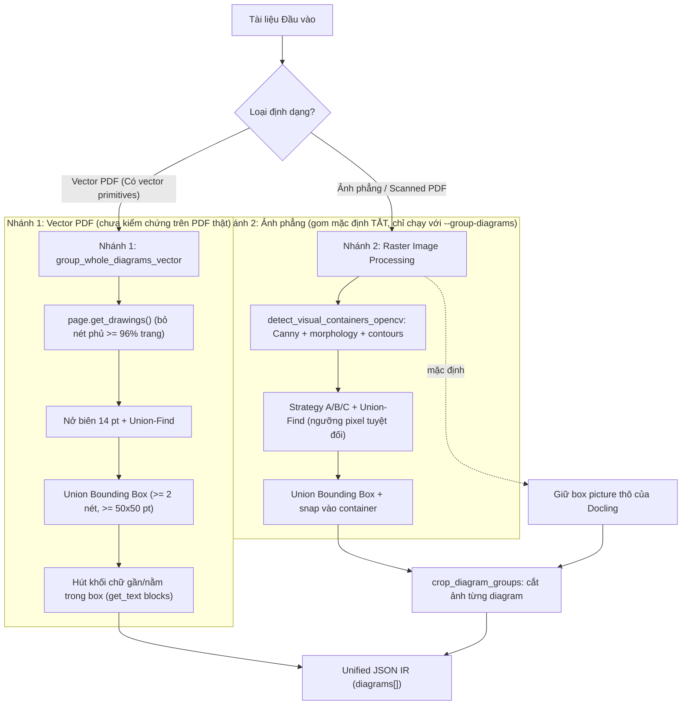

# THUẬT TOÁN GOM CỤM SƠ ĐỒ KHỐI TOÀN VẸN (`group_whole_diagrams`)

Tài liệu này đặc tả kiến trúc thuật toán và kết quả thực nghiệm của hai hàm gom sơ đồ trong `scripts/test_diagram_grouping.py` (**`group_whole_diagrams_vector`** cho PDF vector và **`group_whole_diagrams_image`** cho ảnh phẳng, gọi chung là `group_whole_diagrams`) cùng biến thể thận trọng `scripts/diagram_grouping_v2.py` trong hệ thống **DocuMind**.

> **Trạng thái hiện tại (đọc trước):**
> - **Gom sơ đồ trên ảnh phẳng đang TẮT mặc định.** Pipeline giữ nguyên box `picture`/`figure` thô của Docling (mỗi box là một mục `diagrams[]`, `metadata.grouping = "raw_picture"`) và bật lại gom v1 bằng cờ `--group-diagrams`. Lý do: với OCR bật, box thô đạt micro-F1 **0,766** còn sau gom v1 chỉ **0,281** (100 trang, `outputs/05_diagram_crop_eval/results.json`); với OCR tắt, v1 sửa 11/38 hình bị vỡ nhưng làm hỏng 166/1.057 hình đang đúng (mục 5).
> - **Nhánh vector chưa từng được kiểm chứng trên PDF thật**, chỉ trên PDF tổng hợp do chính code sinh ra.
> - **Node/edge và mã Mermaid không được tự động trích xuất từ ảnh hay PDF.** Dữ liệu node/edge duy nhất nằm hard-code trong phần demo của `test_diagram_grouping.py`.
> - Các con số "gom hoàn hảo" ở mục 5 là quan sát định tính trên vài mẫu demo, không phải đo lường định lượng.

---

## 1. Đặt Vấn Đề (Problem Statement)

Trong các tài liệu kỹ thuật, slide báo cáo, giáo trình và tài liệu kiến trúc hệ thống, các sơ đồ (flowchart, architecture diagram, network topology, infographic) thường được cấu thành từ:
- Nhiều hình khối hình học rời rạc (chữ nhật, ellipse, hình thoi).
- Các đường kẻ, mũi tên kết nối (lines, arrows, orthogonal connectors).
- Các nhãn văn bản nằm bên trong hình khối hoặc nằm cạnh đường kẻ.

### Hiện tượng lỗi của các bộ phân tích tài liệu truyền thống:
Các mô hình Object Detection / OCR tiêu chuẩn (như Docling Layout, LayoutLM, PaddleOCR) khi gặp sơ đồ thường gặp 2 lỗi nghiêm trọng:
1. **Bị cắt vụn (Over-fragmentation):** Xé nhỏ 1 sơ đồ thành 20–30 mẩu nhỏ (mỗi hình hộp là 1 `picture`, mỗi dòng chữ là 1 `text`, các mũi tên bị bỏ sót). Khi chuyển sang RAG hoặc LLM, ngữ cảnh tổng thể của sơ đồ bị phá hủy hoàn toàn.
2. **Chỉ bắt một phần (Partial Detection):** Chỉ nhận diện được 1-2 khối ảnh nhỏ bên trong sơ đồ, bỏ rơi toàn bộ phần khung viền, mũi tên và ghi chú xung quanh.

### Mục tiêu kỹ thuật:
Xây dựng thuật toán **`group_whole_diagrams()`** nhằm xác định **TOÀN BỘ khung bao lớn nhất (Union Bounding Box)** của từng cụm sơ đồ/card độc lập, đồng thời gom toàn bộ các phần tử con bên trong vào một thực thể duy nhất dạng `diagram`.

---

## 2. Kiến Trúc Thuật Toán 2 Nhánh (Two-Branch Architecture)

Hệ thống xử lý linh hoạt theo 2 dạng đầu vào:

---

## 3. Chi Tiết Nhánh 1: Xử Lý PDF Vector (`group_whole_diagrams_vector`)

Khi tài liệu là file PDF kỹ thuật số, PyMuPDF cho phép truy xuất trực tiếp các nét vẽ hình học thông qua `page.get_drawings()`. Hàm `group_whole_diagrams_vector(pdf_path, page_num=0, pad=14.0)` hoạt động như sau.

### Bước 1: Trích xuất Vector Primitives
Mỗi drawing path được lấy hình chữ nhật bao quanh $\text{bbox}(p) = [x_1, y_1, x_2, y_2]$. Bộ lọc **duy nhất** ở bước này là bỏ các nét có kích thước $\ge 96\%$ cả chiều rộng và chiều cao trang (viền/nền trang). Code **không** lọc các đường kẻ ngắn, đường kẻ bảng hay đường kẻ header/footer, nên chúng có thể nối chuỗi các cụm vào nhau.

### Bước 2: Gần nhau theo khoảng cách `pad`
Hai nét được coi là nối nhau khi khoảng hở giữa hai bbox $\le$ `pad` (mặc định **14 pt**, đơn vị điểm của PDF) theo cả hai trục (`boxes_close_or_intersect`). Giá trị này **cố định**, không phụ thuộc kích thước trang hay kích thước nét vẽ.

### Bước 3: Union-Find (Disjoint Set Union - DSU)
- Mỗi nét là một tập độc lập; với mọi cặp $(i, j)$ thỏa điều kiện ở Bước 2 thì $\text{Union}(i, j)$ (độ phức tạp $O(n^2)$).
- Mỗi cụm có $\ge 2$ nét và khung bao tổng hợp $\ge 50 \times 50$ pt mới được giữ làm ứng viên diagram.

### Bước 4: Hút khối chữ (Text Absorption)
Duyệt các khối chữ của trang (`page.get_text("blocks")`). Khối nào **giao với, nằm trong, hoặc cách khung bao $\le$ `pad`** thì được hút vào và khung bao được **mở rộng ngay** để chứa nó (khung lớn dần trong lúc duyệt, nên các khối chữ kế tiếp cũng có thể bị hút). Rủi ro suy ra từ code: đoạn văn hoặc caption nằm sát sơ đồ có thể bị hút vào. Cuối cùng khung được thêm lề 6 pt.

### Kết quả trả về
Mỗi cụm là một `vector_diagram_group` gồm `bbox`, `primitives_count`, `text_blocks_count`, `text_preview`. **Hàm không phân loại node/edge và không sinh Mermaid.** Phần demo của `test_diagram_grouping.py` gắn tay danh sách `nodes`/`edges` cho PDF lưu đồ tổng hợp để minh họa định dạng IR và khối Mermaid trong Markdown; điều đó không phải là trích xuất tự động.

---

## 4. Chi Tiết Nhánh 2: Xử Lý Ảnh Phẳng / Scanned

Đối với tài liệu ảnh phẳng (PNG/JPG như `OmniDocBench`) không còn thông tin vector. **Mặc định pipeline giữ box `picture`/`figure` của Docling và không gom** (xem trạng thái ở đầu tài liệu). Phần dưới mô tả hàm v1 `group_whole_diagrams_image` khi chạy với `--group-diagrams`.

### Bước 1: Phát hiện container thị giác (`detect_visual_containers_opencv`)
1. Ảnh được đọc qua `read_image_bgr` (an toàn với đường dẫn không-ASCII trên Windows), chuyển xám.
2. `cv2.Canny(gray, 20, 80)`, sau đó `MORPH_CLOSE` với nhân ngang (chiều dài $\max(20, 1{,}5\% W)$) và nhân dọc ($\max(20, 1{,}5\% H)$), hợp lại rồi đóng tiếp với nhân $25 \times 10$.
3. `cv2.findContours(..., cv2.RETR_TREE, ...)`; giữ contour có diện tích từ $0{,}8\%$ đến $85\%$ diện tích trang, rộng $\ge 120$ px, cao $\ge 60$ px; khử trùng lặp bằng NMS (IoU $> 0{,}85$).

### Bước 2: Gom cụm bằng Union-Find (ba chiến lược)
Docling items được đổi sang pixel rồi gom bằng DSU:
- **Strategy A (container):** các item (trừ `section_header`, `list_item`, `title`) nằm trong cùng một container (dung sai 15%) được nối. Bỏ container chiếm $> 35\%$ trang hoặc chứa $\ge 2$ `section_header`/`title`.
- **Strategy B (gần nhau quanh `picture`):** nếu một trong hai item là `picture`/`figure`, khoảng hở ngang $\le 160$ px và hai box cách nhau $\le 45$ px thì nối, **bất kể item kia là gì** (caption, formula, đoạn chữ ngắn đều có thể bị hút vào).
- **Strategy C (thẻ ngang hàng, như timeline):** hai khối không phải picture lệch đỉnh/đáy $< 35$ px, hở ngang $< 140$ px, mỗi khối rộng $< 45\%$ trang.
- Hàng rào: không nối qua `section_header`/`list_item` nằm giữa; không nối hai item ở hai nửa trang (tâm lệch về hai phía của $48\%$/$52\%$ chiều rộng).

### Bước 3: Dựng khung bao
- Mỗi cụm có $\ge 2$ item **hoặc chứa một `picture`** thành một `diagram_group` (nên một picture đơn lẻ cũng bị đóng gói thành diagram).
- Khung bao là union các item; được **snap** theo container nếu IoU $> 0{,}6$ hoặc khung nằm trong container nhỏ hơn $1{,}35\times$; cuối cùng thêm lề 8 px.

### Bước 4: Xuất ảnh crop
`crop_diagram_groups` cắt từng `bbox` từ ảnh gốc và lưu PNG. Trong pipeline Tầng 2 (`run_dataset_stress_test.py`), ảnh nằm ở `<output>/crops/` và đường dẫn tương đối được ghi vào `diagrams[].cropped_image`.

### Hạn chế đã biết
- Toàn bộ ngưỡng là **pixel tuyệt đối** (45, 160, 140, 35, 20, lề 8): kết quả phụ thuộc độ phân giải ảnh.
- Các hàng rào theo nhãn chữ (`section_header`, `list_item`) **không có tác dụng khi Docling tắt OCR**, vì khi đó mọi box chữ bị bỏ.
- Hình bị chữ bao quanh vẫn lẫn chữ khi cắt (box chữ nhật không mô tả được hình lõm); hình trang trí nhỏ (icon, logo) cũng thành crop riêng.

---

## 5. Kết Quả Thực Nghiệm & Đánh Giá

### 5.1. Đo định lượng trên OmniDocBench (kết luận: gom ảnh phẳng không có lợi)

**OCR bật, 100 trang có hình** (`outputs/05_diagram_crop_eval/results.json`): box `picture` thô của Docling (R1) đạt micro-F1@0,5 = **0,766** (recall 0,825); sau gom v1 (R2) chỉ **0,281**. R1 thắng R2 trên 70 trang, thua trên 1 trang. Gom v1 hút caption và đoạn chữ gần hình vào group nên box không còn khớp hình.

**OCR tắt, 613 trang có GT `figure` (1.385 hình), cache `cache_ocr-off_dev-cuda`.** Phân loại GT theo box thô: nguyên vẹn 1.057 (76,3%), bị vỡ 38 (2,7%), bị bỏ sót 275 (19,9%), khác 15.

| Hệ thống | whole@0,5 trên mọi hình | Hình bị vỡ sửa được | Hình đang đúng bị làm hỏng | Hình riêng bị nuốt gần nhau (near-merge) |
|---|---|---|---|---|
| R1: box thô | 76,3% | 0/38 | 0 | 10,7% |
| R3: gom v1 | 65,3% | 11/38 | 166/1.057 (15,7%) | 27,2% |
| R5: v2, cấu hình chọn theo fold (out-of-fold) | 75,7% | 0/38 | 8/1.057 (0,76%) | 11,9% |
| v2 với `GroupParamsV2()` mặc định | 63,0% | 13/38 | 197/1.057 (18,6%) | 33,2% |

- Trong 384 cấu hình của lưới v3, không cấu hình nào thỏa đồng thời "hại $\le 1\%$" và "near-merge $\le$ R1 + 1 điểm %" (`status: no_feasible_config`). Cấu hình triển khai chỉ tạo 7 nhóm trên 613 trang.
- **Veto bổ sung** (`scripts/run_diagram_crop_eval_v4.py`, đặt trên v2 mặc định, đánh giá leave-source-out, tiêu chí đăng ký trước: sửa $\ge 5/38$, hại $\le 1\%$, near-merge $\le$ R1 + 1 điểm %):

  | Veto | Sửa | Hại | near-merge | whole@0,5 (R1 = 1057/1385) |
  |---|---|---|---|---|
  | caption oracle (dùng caption GT, cận trên) | 14/38 | 137 | 24,7% | 934 |
  | khoảng trắng tự chuẩn hóa (OOF) | 3/38 | 15 | 12,5% | 1045 |
  | cả hai (OOF) | 3/38 | 10 | 12,2% | 1050 |

  Không veto nào đạt tiêu chí, và mọi cấu hình đều thấp hơn box thô.
- Đặc trưng cặp mảnh (`scripts/analyze_pair_features.py`): `gap_rel` chỉ có AUC 0,56; mô hình cây/logistic OOF đạt AUC 0,53-0,65. Đặc trưng hình học và khoảng cách không phân biệt được "các mảnh của một hình" với "hai hình riêng nằm gần nhau".
- **Giới hạn của phép đo:** nhãn `figure` của OmniDocBench không nhất quán (lưới 2×2 con dấu bị tách thành 4 GT trong khi hàng clip-art tương tự gộp thành 1), nên nhóm 38 hình "bị vỡ" phần lớn đo quy ước gán nhãn. Gom hoàn hảo cũng chỉ cứu tối đa 31/1.385 hình (+2,2 điểm %), trong khi 275 hình (19,9%) bị bỏ sót hoàn toàn. Chưa đo trên PDF số kiểu AUTOSAR (dữ liệu đích).
- Chi tiết: `docs/04_session_handoff_and_next_steps.md` mục 4.4 và 10.

### 5.2. Quan sát định tính ban đầu (demo, không đo lường)

Bốn mẫu chạy trong `scripts/test_diagram_grouping.py` (Docling OCR bật, gom v1) ở `outputs/02_diagram_grouping/`. Đây là các quan sát trực quan trên vài mẫu chọn trước, **không** phải bằng chứng hiệu quả; mục 5.1 cho thấy trên tập lớn gom v1 làm hại nhiều hơn lợi.

| Mẫu Thử Thách | File Đầu Vào | Trạng Thái Trước Khi Gom (Docling Baseline) | Hiệu Quả Sau Khi Chạy `group_whole_diagrams` | File So Sánh |
|---|---|---|---|---|
| **01. PPT Cards** | `PPT_PresentationSpecification_page_010.png` | 6 khối text và shape bị xé vụn, đè chồng chéo lên nhau. | Gom thành **2 Diagram Cards** độc lập (`diag_0001` Option 1 và `diag_0002` Option 2). | [`01_ppt_cards_compare.png`](../outputs/02_diagram_grouping/01_ppt_cards_compare.png) |
| **02. Network Topology** | `page-9659b897...png` | 18 block gồm các máy trạm, router và nhãn chữ rời rạc. | Gom thành **2 cụm sơ đồ mạng độc lập**: Star Topology và Bus Topology. | [`02_network_topology_compare.png`](../outputs/02_diagram_grouping/02_network_topology_compare.png) |
| **03. Healthcare Infographic** | `page-ec8fe990...png` | 23 mảnh vụn icon, mũi tên, số liệu thống kê. | Gom thành **5 khối infographic** thông tin y tế chuyên biệt. | [`03_healthcare_infographic_compare.png`](../outputs/02_diagram_grouping/03_healthcare_infographic_compare.png) |
| **04. Vector Architecture Flowchart** | `04_vector_flowchart.pdf` | 16 vector primitives (6 boxes, 5 arrows, text labels) không có liên kết. | Gom thành **1 Diagram**; 6 nút và 5 cạnh Mermaid trong IR do demo gắn tay, không phải trích xuất tự động. | [`04_vector_flowchart_compare.png`](../outputs/02_diagram_grouping/04_vector_flowchart_compare.png) |
