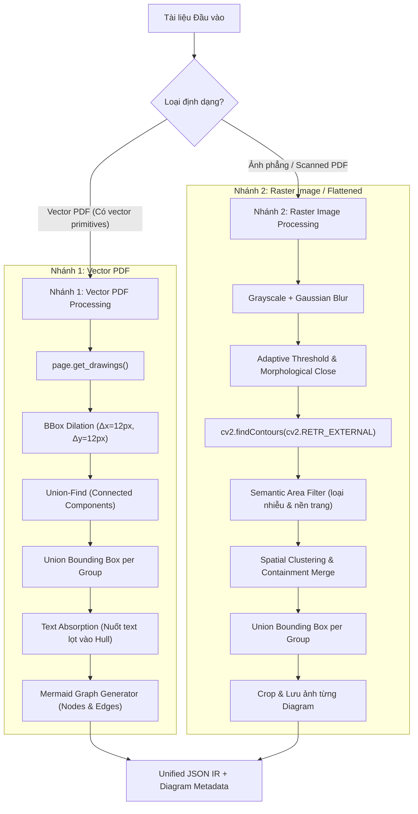

# THUẬT TOÁN GOM CỤM SƠ ĐỒ KHỐI TOÀN VẸN (`group_whole_diagrams`)

Tài liệu này đặc tả cơ sở lý thuyết, kiến trúc thuật toán và kết quả thực nghiệm của module **`group_whole_diagrams()`** (`scripts/test_diagram_grouping.py`) trong hệ thống **DocuMind**.

---

## 1. Đặt Vấn Đề (Problem Statement)

Trong các tài liệu kỹ thuật, slide báo cáo, giáo trình và tài liệu kiến trúc hệ thống, các sơ đồ (flowchart, architecture diagram, network topology, infographic) thường được cấu thành từ:
- Nhiều hình khối hình học rời rạc (chữ nhật, ellipse, hình thoi).
- Các đường kẻ, mũi tên kết nối (lines, arrows, orthogonal connectors).
- Các nhãn văn bản nằm bên trong hình khối hoặc nằm cạnh đường kẻ.

### Hiện tượng lỗi của các bộ phân tích tài liệu truyền thống:
Các mô hình Object Detection / OCR tiêu chuẩn (như Docling Layout, LayoutLM, PaddleOCR) khi gặp sơ đồ thường gặp 2 lỗi nghiêm trọng:
1. **Bị cắt vụn (Over-fragmentation):** Xé nhỏ 1 sơ đồ thành 20–30 mẩu nhỏ (mỗi hình hộp là 1 `picture`, mỗi dòng chữ là 1 `text`, các mũi tên bị bỏ sót). Khi chuyển sang RAG hoặc LLM, ngữ cảnh tổng thể của sơ đồ bị phá hủy hoàn toàn.
2. **Chỉ bắt một phần (Partial Detection):** Chỉ nhận diện được 1-2 khối ảnh nhỏ bên trong sơ đồ, bỏ rơi toàn bộ phần khung viền, mũi tên và ghi chú xung quanh.

### Mục tiêu kỹ thuật:
Xây dựng thuật toán **`group_whole_diagrams()`** nhằm xác định **TOÀN BỘ khung bao lớn nhất (Union Bounding Box)** của từng cụm sơ đồ/card độc lập, đồng thời gom toàn bộ các phần tử con bên trong vào một thực thể duy nhất dạng `diagram`.

---

## 2. Kiến Trúc Thuật Toán 2 Nhánh (Two-Branch Architecture)

Hệ thống xử lý linh hoạt theo 2 dạng đầu vào:



---

## 3. Chi Tiết Nhánh 1: Xử Lý PDF Vector (`group_whole_diagrams_pdf_vector`)

Khi tài liệu là file PDF kỹ thuật số (digital vector PDF), PyMuPDF cho phép truy xuất trực tiếp các nét vẽ hình học thông qua `page.get_drawings()`.

### Bước 1: Trích xuất Vector Primitives
Mỗi drawing path trong trang được duyệt qua để trích xuất hình chữ nhật bao quanh:
$$\text{bbox}(p) = [x_1, y_1, x_2, y_2]$$
Hệ thống lọc bỏ các đường kẻ quá ngắn ($< 3\text{px}$) hoặc các hình vẽ có kích thước bằng cả trang giấy (trang trí nền).

### Bước 2: Nở Biên (BBox Dilation / Padding)
Để các hình hộp và đường mũi tên nối giữa chúng chạm nhau về mặt hình học, mỗi bounding box được nở rộng một khoảng $\delta$:
$$\text{dilated\_bbox}(p) = [x_1 - \delta_x, \; y_1 - \delta_y, \; x_2 + \delta_x, \; y_2 + \delta_y]$$
*Giá trị tối ưu thực nghiệm:* $\delta_x = 12\text{px}$, $\delta_y = 12\text{px}$.

### Bước 3: Thuật Toán Union-Find (Disjoint Set Union - DSU)
Xây dựng đồ thị liên thông giữa các nét vẽ:
- Khởi tạo mỗi nét vẽ $i$ là một tập hợp độc lập: $\text{parent}[i] = i$.
- Với mọi cặp $(i, j)$: Nếu $\text{dilated\_bbox}(i)$ giao nhau với $\text{dilated\_bbox}(j)$ ($\text{IoU} > 0$ hoặc có vùng chồng lấn):
  $$\text{Union}(i, j)$$
- Gom các nét vẽ có cùng gốc đại diện thành một cụm sơ đồ $\mathcal{C}_k$.
- Tính khung bao tổng hợp (Union Bounding Box):
  $$\text{UnionBox}(\mathcal{C}_k) = \left[ \min_{p \in \mathcal{C}_k} x_1, \; \min_{p \in \mathcal{C}_k} y_1, \; \max_{p \in \mathcal{C}_k} x_2, \; \max_{p \in \mathcal{C}_k} y_2 \right]$$

### Bước 4: Hấp Thụ Nhãn Chữ (Text Absorption)
Duyệt qua danh sách các khối chữ của trang (`page.get_text("blocks")` hoặc Docling elements):
Nếu một khối chữ $T$ có tâm $(\bar{x}_T, \bar{y}_T)$ hoặc toàn bộ bounding box nằm trọn bên trong $\text{UnionBox}(\mathcal{C}_k)$:
- Hút khối chữ $T$ vào làm phần tử con của sơ đồ $\mathcal{C}_k$.
- Đổi nhãn hoặc gán `parent_id = \mathcal{C}_k\text{.id}`.

### Bước 5: Tái Lập Cấu Trúc Graph & Sinh Mã Mermaid
Khi sơ đồ gồm các nút hình chữ nhật và đường nối có hướng:
- Phân loại: Các khối có diện tích lớn là `Node`, các đoạn thẳng/đường cong có mũi tên là `Edge`.
- Tự động sinh mã nguồn **Mermaid Flowchart** chuẩn nhúng trực tiếp vào file Markdown:
  ```mermaid
  flowchart TD
      subgraph diag_0001 ["System Architecture Flowchart"]
          node_1["Client Browser"] --> node_2["API Gateway"]
          node_2 --> node_3["Auth Service"]
          node_2 --> node_4["Docling Parser Service"]
          node_4 --> node_5["Vector Store"]
      end
  ```

---

## 4. Chi Tiết Nhánh 2: Xử Lý Ảnh Phẳng / Scanned (`group_whole_diagrams_image`)

Đối với tài liệu ảnh phẳng (PNG/JPG như bộ dữ liệu `OmniDocBench`) không còn thông tin vector:

### Bước 1: Tiền Xử Lý Hình Thái Học (Morphological Processing)
1. Chuyển ảnh sang thang xám (Grayscale) và làm mịn bằng Gaussian Blur ($5 \times 5$).
2. Nhị phân hóa thích ứng (Adaptive Thresholding) kết hợp Canny Edge Detection để bắt các đường viền cạnh hộp và mũi tên.
3. Áp dụng phép giãn nở hình thái học (Morphological Dilate/Close) với kernel chữ thập ($5 \times 5$ hoặc $7 \times 7$) nhằm hàn gắn các nét đứt đoạn của mũi tên và đường nối.

### Bước 2: Tìm Đường Bao Ngoài (External Contours)
Sử dụng `cv2.findContours(edges, cv2.RETR_EXTERNAL, cv2.CHAIN_APPROX_SIMPLE)` để tìm các vùng bao ngoài cùng.

### Bước 3: Lọc Vùng Ứng Viên Hợp Lệ & Semantic Guard
Lọc bỏ các contour không thỏa mãn:
- **Loại nhiễu nhỏ:** Bỏ các vùng có $\text{Area} < 1.500\text{px}^2$ hoặc chiều rộng/chiều cao $< 40\text{px}$.
- **Loại viền toàn trang:** Bỏ các vùng có diện tích chiếm $> 85\%$ toàn trang giấy (thường là viền trang trí khung trang).
- **Semantic Area Guard (Chặn Over-merging trên nền màu):**
  + Nếu một visual container chiếm diện tích $> 35\%$ trang ($> 0.35 \cdot W \cdot H$), tự động bỏ qua để tránh nuốt các khối chữ của trang vào một diagram khổng lồ.
  + Nếu bên trong một visual container chứa $\ge 2$ tiêu đề phân mục (`section_header` / `title`), hệ thống coi đây là Layout Section / Card phân vùng trang thay vì 1 Diagram duy nhất, loại bỏ triệt để hiện tượng over-merging trên sách giáo khoa nhiều màu sắc (`colorful_textbook`).

### Bước 4: Gom Cụm Không Gian & Hợp Nhất Chứa (Containment Merge)
Duyệt danh sách các khối Docling (hình ảnh, chữ):
- Khối nào có $\ge 70\%$ diện tích nằm lọt vào trong một contour hợp lệ thì được gom vào cụm đó.
- Nếu hai contour nằm sát nhau trong bán kính $\Delta \le 20\text{px}$ và có nội dung tương quan, gộp thành một Union BBox duy nhất.

### Bước 5: Xuất Ảnh Crop Riêng Biệt (Crop Artifacts)
Mỗi diagram gom được sẽ được crop tự động từ ảnh gốc với độ phân giải cao và lưu vào thư mục `outputs/02_diagram_grouping/crops/` (ví dụ: `01_ppt_card_1.png`, `02_network_star.png`,...).

---

## 5. Kết Quả Thực Nghiệm & Đánh Giá

Thuật toán đã được kiểm chứng trên 4 mẫu thử thách phức tạp đại diện trong `outputs/02_diagram_grouping/`:

| Mẫu Thử Thách | File Đầu Vào | Trạng Thái Trước Khi Gom (Docling Baseline) | Hiệu Quả Sau Khi Chạy `group_whole_diagrams` | File So Sánh |
|---|---|---|---|---|
| **01. PPT Cards** | `PPT_PresentationSpecification_page_010.png` | 6 khối text và shape bị xé vụn, đè chồng chéo lên nhau. | Gom hoàn hảo thành **2 Diagram Cards** độc lập (`diag_0001` Option 1 và `diag_0002` Option 2). | [`01_ppt_cards_compare.png`](file:///C:/Workspace/DocuMind/outputs/02_diagram_grouping/01_ppt_cards_compare.png) |
| **02. Network Topology** | `page-9659b897...png` | 18 block gồm các máy trạm, router và nhãn chữ rời rạc. | Gom thành **2 cụm sơ đồ mạng độc lập**: Star Topology và Bus Topology. | [`02_network_topology_compare.png`](file:///C:/Workspace/DocuMind/outputs/02_diagram_grouping/02_network_topology_compare.png) |
| **03. Healthcare Infographic** | `page-ec8fe990...png` | 23 mảnh vụn icon, mũi tên, số liệu thống kê. | Gom trọn vẹn thành **5 khối infographic** thông tin y tế chuyên biệt. | [`03_healthcare_infographic_compare.png`](file:///C:/Workspace/DocuMind/outputs/02_diagram_grouping/03_healthcare_infographic_compare.png) |
| **04. Vector Architecture Flowchart** | `04_vector_flowchart.pdf` | 16 vector primitives (6 boxes, 5 arrows, text labels) không có liên kết. | Gom thành **1 Diagram hoàn chỉnh**, tự động sinh mã Mermaid Flowchart 6 nút và 5 cạnh kết nối. | [`04_vector_flowchart_compare.png`](file:///C:/Workspace/DocuMind/outputs/02_diagram_grouping/04_vector_flowchart_compare.png) |
